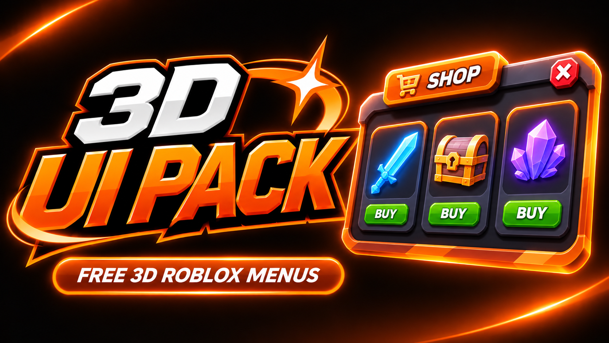
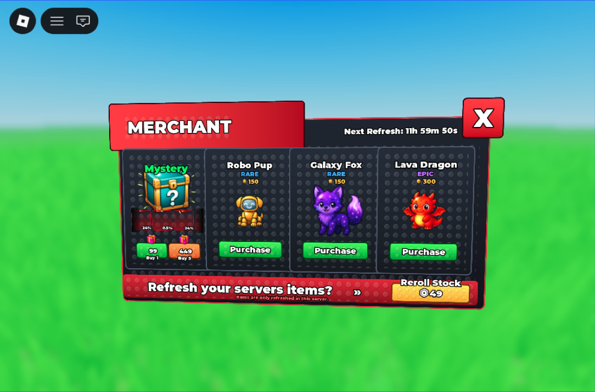
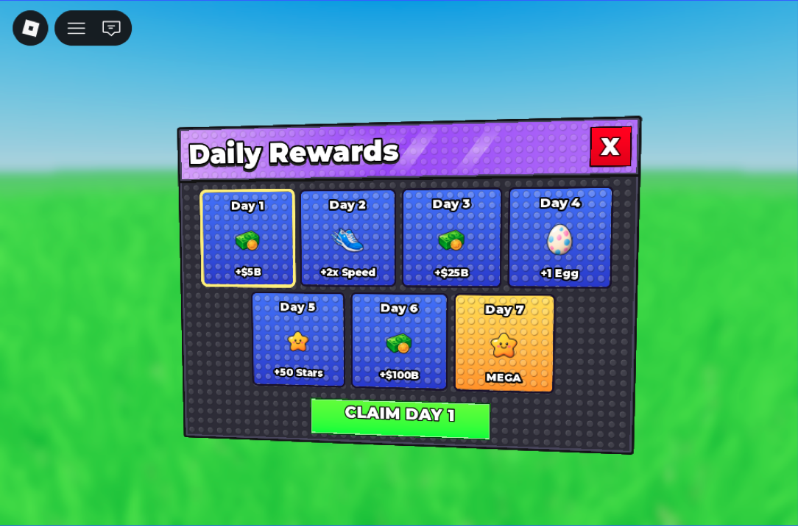
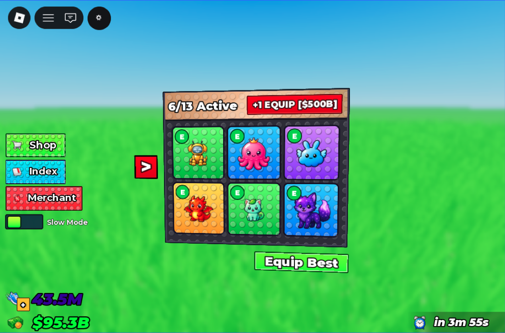
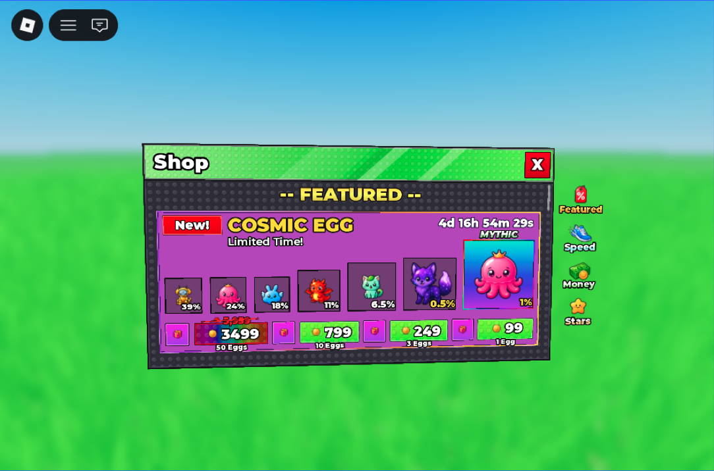
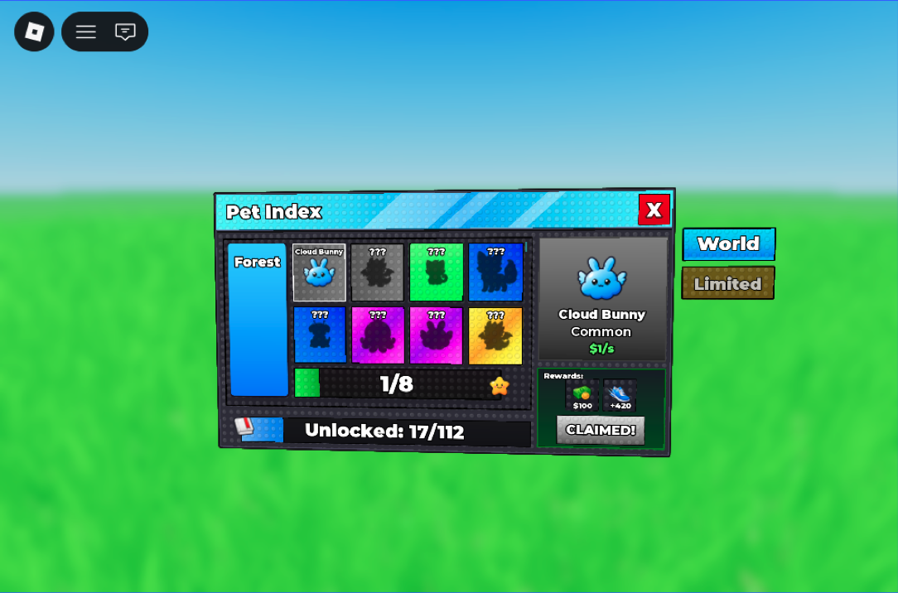
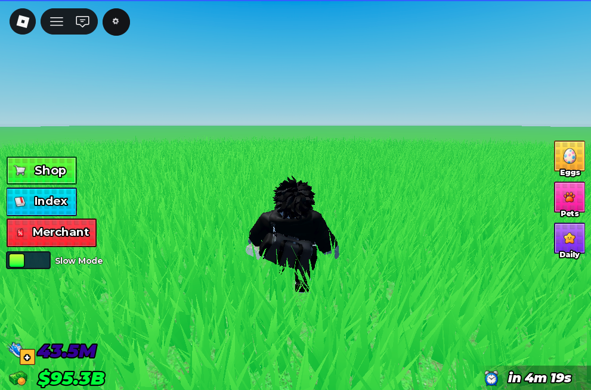

# 3D UI Pack for Roblox (free)

A full simulator UI for your Roblox game where **every menu floats in 3D**: it swings in when it opens, tilts toward
your mouse, and the world blurs behind it.

Made by **@momentumcash**. Free to use in your games.





## What you get

- **HUD:** Shop, Index and Merchant buttons, Eggs / Pets / Daily tabs, money + speed counters, a timer
- **Shop:** featured egg, bundles, category tabs, hover tooltips
- **Pet Index:** worlds, locked / unlocked pets, rewards
- **Merchant:** stock cards with PURCHASE, Reroll Stock, a refresh timer, and a Mystery Crate that spins and lands on a pet
- **Daily Rewards:** 7 days, CLAIM counts your money up
- **Settings:** music / SFX sliders, toggles
- **Eggs + Pets drawers**
- All of it in 3D: each window is its own tilting panel (the `ImmersiveUI` module)

|  |  |
|---|---|
|  |  |



## The files

| File | What it is |
|---|---|
| `files/3D-UI-Pack.rbxl` | The demo place. Open it in Roblox Studio and press **Play**. |
| `files/PUT IN StarterGui - 3D UI Pack.rbxm` | The whole UI. Goes in **StarterGui**. |
| `files/PUT IN ReplicatedStorage - ImmersiveUI.rbxm` | The 3D panel module. Goes in **ReplicatedStorage**. |
| `src/` | Every script as plain text, so you (or your AI) can read it |
| `immersive-ui-skill/` | A Claude Code skill that puts the 3D effect on **your own** menus |

## Set it up with your AI (easiest)

Connect Roblox Studio to Claude Code first: in Studio, **Assistant** > **...** > **Manage MCP Servers** >
**Quick connect** > **Claude Code**. Open your game in Studio, then paste this into Claude Code:

```
Set up the 3D UI Pack for me from https://github.com/momentumcash/3d-ui-pack
Download it, put "PUT IN ReplicatedStorage - ImmersiveUI.rbxm" in ReplicatedStorage and
"PUT IN StarterGui - 3D UI Pack.rbxm" in StarterGui in my open Roblox Studio game,
press Play to check every menu opens and tilts, then change the names, prices and pets to fit my game.
```

## Or set it up yourself (2 minutes)

1. Download this repo: green **Code** button > **Download ZIP**, then unzip it.
2. Open your game in Roblox Studio.
3. Drag `files/PUT IN ReplicatedStorage - ImmersiveUI.rbxm` into the Studio window, then drag the `ImmersiveUI`
   it makes (it lands in Workspace) into **ReplicatedStorage** in the Explorer.
4. Drag `files/PUT IN StarterGui - 3D UI Pack.rbxm` in the same way and move `3DUIPack` into **StarterGui**.
5. Press **Play**. Click **Shop**, **Index** or **Merchant** on the left, or **Eggs / Pets / Daily** on the right.

Just want to look first? Open `files/3D-UI-Pack.rbxl` and press Play.

## Make it yours

Everything in the menus is **demo data on the player's screen**: it looks real but nothing is saved yet.

- **Money, speed, timer:** `3DUIPack > Scripts > Fixtures`
- **Shop egg, prices, odds:** `Scripts > ShopData`
- **Merchant stock + crate:** `Scripts > Merchant` (it uses the Shop's pets)
- **Pets:** Cloud Bunny, Lava Dragon, Leaf Cat, Galaxy Fox, Robo Pup, Jelly King. Swap the `Image` on any `Pet` to use your own
- **Daily rewards:** the `DAYS` list at the top of `Scripts > Rewards`
- **Turn the 3D off / change the tilt:** `Scripts > Immersive` (the `Tilt`, `ScreenHeight` and `Blur` options)

**Hook it up to your game:** when a player buys or claims something, the UI sets an attribute on the `3DUIPack`
ScreenGui: `BuyRequest` (Merchant card), `RollRequest` (Mystery Crate) and `ClaimRequest` (Daily Rewards). Listen for
those with `GetAttributeChangedSignal` in a LocalScript and fire your own RemoteEvent to the server. Do the real
money check on the server, never on the client.

## Heads-up

- All the art (pets, icons, stud texture) is original and free to use in your games. The pictures load from Roblox,
  so give them a second the first time you press Play.
- On phones the 3D tilt follows your finger for a second after a tap.
- Studio only saves when **you** save: **File > Save to File**.

Questions? DM me in the Discord.
